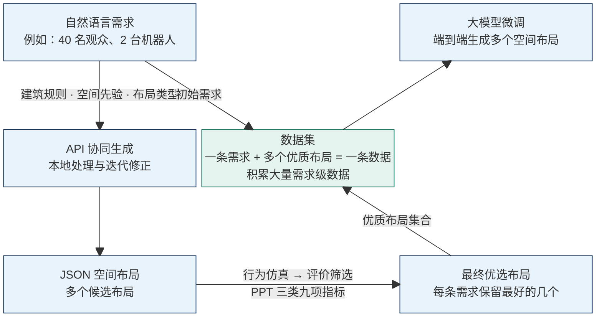

# CoSPADE: Behavior-Grounded Spatial Generation and Evaluation for Human–Robot Co-Performance

**面向人机共演的行为驱动空间生成与评价**  
更新日期：2026 年 11 月 3 日

## 一、项目目标与总体架构

CoSPADE 面向讲演、展示和交互等人机共演活动，研究如何融合建筑知识、本地计算与模型 API，从自然语言需求生成多个空间布局，再通过行为仿真与评价筛选保留其中最好的几个。将一条输入需求与对应的多个优质布局组成一条数据，积累大量这样的数据，用于微调端到端布局生成模型。

初始场地为**自强科技楼三楼通高空间**。架构图以“40 名观众、2 台机器人”为需求示例；PPT 展示的初步场景包含 1 台机器人和 3 名参与者，规模扩展仍需验证。

架构图以 Mermaid 网格源码维护：左侧竖向生成，中央汇集数据，右上进行微调，右下保留优选布局。可修改节点文字与连线，通过 `space` 调整留白和位置。

整个项目分为四个相互连接的过程：

- **布局生成：** 解析活动需求，融合建筑规则、空间先验与布局类型，通过本地处理和 API 协同生成多个 JSON 布局。
- **行为仿真：** 在统一的人机共存场景中运行候选布局，记录行为、轨迹与任务数据。
- **评价筛选：** 根据仿真记录计算 PPT 的三类九项指标，为每条需求筛选出最好的几个布局。
- **数据学习：** 将每条需求及其多个优质布局组成一条数据，积累训练集，微调端到端布局生成模型。

核心研究是**设计多种能力协同的空间布局生成流程，并通过具有行为依据的评价检验生成结果**。

## 二、空间布局生成

图中的“自然语言—API—JSON”概括输入、模型调用与输出。实际生成过程需要组织需求、建筑知识、空间关系和几何计算，本地处理贯穿 API 调用前后。

### 输入条件

| 输入 | 主要内容 |
| --- | --- |
| 活动需求 | 活动类型、人数、机器人数量与角色、任务、观看目标 |
| 建筑规则 | 场地边界、保留构件、布置限制及通行要求 |
| 空间先验 | 功能分区、观看关系、入口与任务区域的组织经验 |
| 布局类型 | 可选的空间组织方式、模块组合与可调参数 |
| 场地与设施 | 可布置区域、固定设施、模块尺寸与库存 |

### 生成流程

| 环节 | 主要工作 | 输出 |
| --- | --- | --- |
| 需求解析 | 提取活动条件，识别缺失信息，组织适用规则与先验 | 结构化需求与约束 |
| 本地场地分析 | 处理边界、固定设施和模块尺寸，计算可布置范围 | 场地表达与可行范围 |
| API 协同生成 | 结合需求和建筑知识，推导分区、空间关系、布局策略或参数 | 多个候选方案 |
| 本地几何处理 | 将方案落实为设施、座位或站位、通道和任务点的位置与朝向 | 候选布局 JSON |
| 校核与修正 | 检查格式、边界、重叠、必需元素和静态可达性，反馈问题并修正 | 可进入仿真的候选布局 |

这些环节可以迭代：局部几何问题由本地计算修正；空间组织无法满足条件时，返回方案生成环节调整。API 的调用时机、具体职责与求解方法通过原型确定。

JSON 是各模块交换布局的载体，至少需要统一坐标、单位、对象类型、尺寸、位置、朝向，以及任务与配置引用。每个候选同时保留需求、规则、生成版本和校核记录，便于复现。

**本模块输出：多个满足基本约束、可加载到仿真场景的 JSON 布局。**

## 三、行为仿真

### 行为依据

PPT 提供动作捕捉、行为语义、眼动和空间位置四类记录，用于提取行为特征、交互语义及站位等参数，建立可调的行为代理。这构成项目中“Behavior-Grounded”的依据。

现有数据主要支持人体上半身行为分析，机器人位置与路径由视频估计；行走参数和更大规模场景的适用性需进一步验证。

### 场景运行与数据记录

将候选布局、固定任务脚本和行为代理加载到人机共存场景，同步记录位置、朝向、状态、观看条件、指令和交互事件。PPT 提出的平台采用 Unreal Engine / MassAI。

各布局固定需求、人数、机器人角色、任务与请求清单、设施库存、行为模型和控制策略，使用配对随机种子、多次重复，保证后续比较具有一致条件。

**本模块输出：按布局与运行编号组织的同步行为日志、轨迹、任务记录及仿真配置。**

## 四、评价筛选

以行为仿真输出的同步记录为输入，计算评价指标、比较候选方案并形成优选依据。

### 评价指标

**评价筛选以 PPT 第 7–10 页及备注中的三类九项指标为准。** 三类指标都来自同一人机共存场景，分别描述观众观看条件、双方关系和机器人执行表现。

| 类别 | 指标 | 定义与方向 |
| --- | --- | --- |
| 人 | 目标无遮挡率 | 眼点至目标的无遮挡射线占比，越高越好 |
| 人 | 观看偏角 | 躯干前向与目标方向的水平夹角，报告 P90，越低越好 |
| 人 | 观看距离达标率 | 视距处于统一任务区间的采样占比，越高越好 |
| 人机 | 交互构型达成率 | 在时限内持续满足距离与相对朝向要求的请求占全部预设有效请求的比例，越高越好 |
| 人机 | 就绪重合率 | 预设交互窗内双方同时就绪的时间占比，越高越好 |
| 人机 | 危险接近事件率 | 结合外廓间距、接近趋势和 TTC 判定的独立事件数／固定观察分钟数，越低越好 |
| 机器人 | 指令完成率 | 按统一时限与容差完成的指令占全部预设指令的比例，越高越好 |
| 机器人 | 指令执行耗时 | 从下发到达成的受限平均耗时；未完成按统一任务时限计，越低越好，结合完成率判断 |
| 机器人 | 路径执行效率 | 成功且非零移动任务的静态最短可行路程／实际路程，越高越好，结合完成情况判断 |

统计时统一观看目标与时段、任务阈值和采样规则。双方就绪由各自任务状态机判定；危险接近的连续帧合并为事件；失败和超时指令保留在完成率分母。不适用指标记为 N/A。

### 比较与筛选

以一次完整仿真运行为统计单位，汇总九项指标的运行间分布与差异。

先校核碰撞、静态不可达等硬约束，再比较九项指标。各方案使用相同归一化标尺，按维度呈现优势与权衡；具体优选规则需预先明确。

**本模块输出：每条需求对应的多个优选布局 JSON、空间示意、九项指标结果及筛选依据。**

## 五、数据集与模型微调

### 一条数据的构成

**一条数据 = 一条初始输入需求 + 该需求下筛选出的多个优质布局。**

| 样本组成 | 内容 |
| --- | --- |
| 输入 | 一条完整的初始需求及其场地条件 |
| 目标输出 | 该需求下通过评价筛选的多个优质布局，以 JSON 集合保存 |

例如，同一条“40 名观众、2 台机器人”的需求生成多个候选，仿真评价后保留布局 A、B、C，则该需求与这三个布局共同构成一条数据。评价结果与筛选依据作为附属记录保存，便于追溯样本质量。

### 数据积累与微调

对大量不同需求重复“生成—仿真—评价筛选”，形成多条需求级数据。数据应覆盖不同人数、机器人角色、活动任务和空间条件；同一需求下的布局数量与需求样本数量分别统计。

微调所需数据量取决于基础模型能力、布局表达复杂度、任务覆盖范围和样本质量。先用小规模数据验证训练格式与效果，再根据验证集表现逐步扩大需求覆盖。手写图中约 10K 可作为早期规模设想，若沿用该目标，应明确按上述需求级数据计数。

使用这类“单条需求—多个优质布局”样本微调大模型，目标是使模型在接收新需求后，直接输出多个空间布局，实现端到端生成。训练与测试按需求族或场地划分，模型效果继续通过统一的约束检查和九项指标验证。

**本模块输出：由大量需求级样本组成的数据集，以及从输入需求直接生成多个布局的端到端大模型。**

## 六、研究实施

PPT 已报告行为数据处理、参数提取、初步场景和九项评价定义；生成流程、规则与类型库、数据集及微调方法仍需落实。PPT 备注说明 MassAI 相关 C++ 当时尚未编译验证，完整平台运行状态需结合工程和日志核验。

下一步先完成一个需求明确、可复现的流程：

1. 确定活动、场地、设施与规则，明确本地处理和 API 的分工。
2. 生成多个 JSON 布局，完成几何校核和迭代修正。
3. 固定行为与任务条件，运行仿真并保存同步记录。
4. 根据记录计算九项指标，为该需求筛选出多个优质布局。
5. 将该需求与优选布局集合组成一条数据，扩展到大量不同需求，再开展端到端模型微调。

**素材依据：** [项目 PPT](ppt.pptx)、手写架构图、确认后的架构图。数据与初步结果按材料转述，具体实现与数值以原始数据、工程和日志为准。
